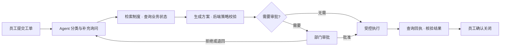
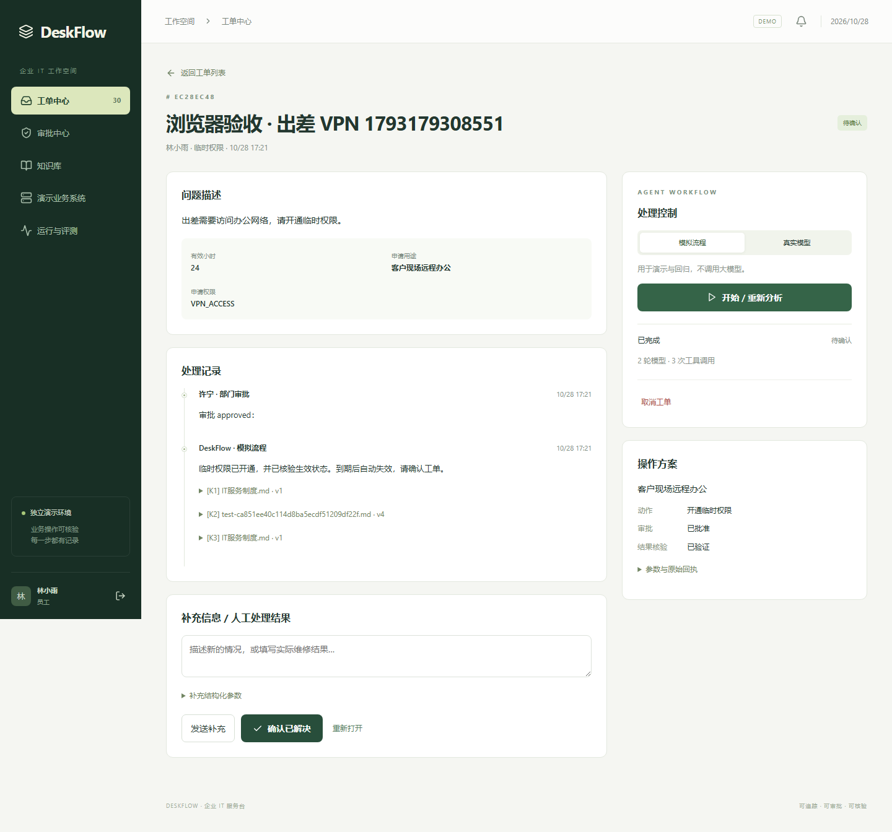

# DeskFlow · 企业 IT 工单 Agent

[](https://github.com/Juen-Liang/service-desk-agent/actions/workflows/ci.yml)

单企业 IT 服务台：从员工求助到制度检索、业务核对、人工审批、受控执行和结果确认。业务 API、工单平台和大模型职责分开，演示账号与工单登录账号分开。

技术栈：Python / FastAPI / LangGraph / PostgreSQL / pgvector / SQLAlchemy / Vue 3 / TypeScript。



本机验证已完成 52 项后端测试、2 条浏览器端到端验证，以及 30/30 固定模拟流程任务；已验证真实服务进程重启后的审批续跑。真实模型效果与容器运行验收分别记录，不以模拟结果替代。详细范围见 [验证记录](VALIDATION.md)。

## 界面预览



截图来自本机模拟流程验收，员工与业务数据均为演示数据。

## 本机入口

- 工作台：<http://127.0.0.1:5178>
- API 文档：<http://127.0.0.1:8011/docs>
- 演示业务 API：本机 8012 端口，仅接受独立服务凭据。
- 登录账号：`employee`、`employee2`、`support`、`approver`、`admin`。随机密码见本项目 `data/demo-credentials.json`，该文件及 `.env` 不提交 Git。

角色：员工查看本人记录；IT 处理人员处理工单；部门审批人员审批所属部门的非本人申请；管理员管理配置，不自动拥有审批权限。

## 已实现

- 账号解锁：仅允许在职普通员工本人、登录失败锁定；特权、安全锁定、停用等情况转人工。
- 临时权限：VPN_ACCESS / DEV_READONLY，默认 24 小时、最长 168 小时；部门审批后执行，到期立即视为无效，后台补齐回收记录。
- 软件授权：IDE_PRO / DIAGRAM_TOOL，审批、事务检查名额和分配；无名额时转人工。
- 设备报障：本人设备查询、知识依据、人工接管和维修结果，员工确认后关闭。
- 六个页面：工单中心、审批中心、知识库、演示业务系统、运行与评测、设置。
- LangGraph + PostgreSQL Checkpointer：按节点保存、待审批中断、预算暂停、故障继续；重启后使用同一 run_id。
- 身份与策略校验、审批绑定方案版本、业务操作幂等、执行回执与结果核验、停止和人工接管。
- 模型自主调用 6 个只读工具；修改操作只由后端验证后的执行节点调用业务 API。
- Markdown、TXT、DOCX、文本 PDF 资料导入，来源定位、版本保留、全文与 1024 维向量混合检索。没有 Embedding 时明确显示“仅全文检索”；新版本失败保留旧有效版本。
- SSE 处理进展和断线续读、站内通知、运行轨迹、独立模型连接测试、API Key 加密。
- 30 个固定评测任务：20 个开发样例、10 个保留验证样例；模拟流程与真实模型模式分别记录，报告可导出 Markdown。

## Windows 原生启动

要求：Python 3.13、Node.js 22（或满足 Vite 7 要求的版本）、PostgreSQL 与 pgvector。当前实现未安装 WSL 或 Docker。

首次安装：

```powershell
git clone https://github.com/Juen-Liang/service-desk-agent.git
cd service-desk-agent
python -m venv .venv
.\.venv\Scripts\python.exe -m pip install -r backend\requirements.txt
cd frontend
npm ci
cd ..\backend
..\.venv\Scripts\python.exe -X utf8 bootstrap.py
cd ..
```

`bootstrap.py` 提示输入 PostgreSQL 管理员密码，只创建 `service_desk_agent`、`service_desk_demo` 和 `deskflow_app`、`deskflow_demo` 两个专用角色。遇到同名且属于其他账号的数据库会停止。不会删除既有数据库，也不会覆盖现有随机密钥和用户密码。

启动与停止：

```powershell
.\scripts\start.ps1
.\scripts\stop.ps1
```

启动脚本在后台运行 API、演示业务、Worker、Vite 四个进程，日志在 `data/*.log`。停止脚本核对启动时间和可执行文件，仅停止自身记录的进程。若出现端口占用，先检查日志，勿重复启动。

## 第一次演示

1. 用 `employee` 登录，提交“业务账号因连续登录失败被锁定”，类型选“账号解锁”。
2. 在工单中选择“模拟流程”，开始分析；查看工具记录、已核验的业务回执，确认关闭。
3. 新建“临时权限”工单，填写 VPN、期限和用途，开始分析后会等待审批。
4. 用另一个浏览器上下文登录 `approver`，在审批中心批准具体方案；回员工页面查看执行结果并确认。
5. 软件授权同样走审批；设备故障转 `support` 接管并记录维修结果。
6. 用 `admin` 查看模型设置、用户角色和演示账号场景。场景初始化只改变选中演示账号状态，不清除历史授权或回执。

## 真实模型与知识库

管理员分别配置对话和 Embedding 的 Base URL、模型 ID、API Key。对话接口使用 OpenAI 兼容的 `/chat/completions` 流式协议及 Tool Calling，`tool_choice=auto`；Embedding 使用 `/embeddings`、1024 维，每批最多 10 条。接口测试不自动保存输入，成功和失败都会返回具体结果。

选择“真实模型”才调用配置的对话服务；模拟模式为确定性规则驱动的开发验证，不代表真实模型智能或准确率。未提供真实 Key，不能完成真实模型效果验收。服务不会自动读取其他项目密钥。

资料入库未配置 Embedding 时可使用全文检索；设置向量模型后对资料“重新入库”，形成新版本。更换向量模型时不混用旧模型向量，暂退回全文检索并显示原因。历史回答保存实际提供给模型的引用片段，资料更新不改变旧回答证据。扫描 PDF、含图片 DOCX 不会被静默标为完整解析。

系统 Prompt 可在设置中编辑并命名版本。开始运行时保存模型和 Prompt 快照；继续原任务不会切换为新的模型配置。API Key 为加密值，模型上下文和前端接口不返回密钥。部署时应备份 `.env` 中的加密主密钥，否则原模型 Key 无法解密。

## 自动化验证

本机服务已启动后：

```powershell
cd backend
..\.venv\Scripts\python.exe -X utf8 -m pytest tests -q
cd ..\frontend
npm run build
npm run test:e2e
cd ..
.\.venv\Scripts\python.exe -X utf8 scripts\run-eval.py
```

浏览器测试需要 Playwright Chromium；缺少时在 frontend 执行 `npx playwright install chromium`。后端测试连接本项目真实数据库，创建有明确测试名称或独立 scope 的数据，不删除其他项目资料。

评测通过标准以工单状态、审批和最终业务数据为依据。模型自述“完成”不作为成功条件。每个评测任务使用独立员工和软件库存，评测运行保留在报告中，不显示在日常工单列表。API 故障和评测执行错误会单独记录，不伪装成业务测试通过。

同一固定任务集可选择不同 Prompt/模型运行，按标签对照报告。不同资料版本的结果不能直接归因为模型变化。Token 仅统计供应商返回的 usage；没有 usage 时不虚构数值，当前不宣称真实成本或性能提升。

## Linux 容器部署准备

已提供 Dockerfile、Compose、Nginx、健康检查和 GitHub Actions。推送后自动在 Linux 环境执行数据库初始化、后端与浏览器测试、前端构建及 Compose 配置检查，实际结果见 [GitHub Actions](https://github.com/Juen-Liang/service-desk-agent/actions)。应用容器的构建与完整运行验收尚未执行，不能用 CI 的 Compose 配置检查替代。

在具备 Docker 的环境中：

```sh
python scripts/configure-compose.py
docker compose --env-file .env.compose config --quiet
docker compose --env-file .env.compose up --build -d
docker compose --env-file .env.compose logs init
```

Compose 新建自己的 PostgreSQL 持久卷、数据库和独立密钥；不会连接本机已有数据库。初始化完成后可用 `docker compose --env-file .env.compose exec api cat /app/data/demo-credentials.json` 查看该环境的随机演示凭据。只发布本机 5178 端口；公开部署需配置域名、TLS、Cookie Secure 和备份。

当前 Windows 原生启动不依赖 WSL 或 Docker；容器环境的安装位置和数据目录由部署者自行选择。

## 重要边界

这是独立演示业务系统，不连接 AD、企业微信、真实 VPN 或生产软件授权服务。演示数据和模拟评测结果不能称为企业线上用户量或真实业务收益。数据库和后端规则保证明确的执行边界；LangGraph 检查点不是业务操作“恰好一次”的保证，外部系统仍需支持操作 ID 和回执查询。

参考：[架构与接口](docs/architecture.md)、[四类业务演示](docs/demo.md)、[验证记录](VALIDATION.md)。
