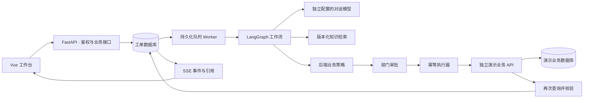

# 架构与接口

## 工作流

prepare → model → tool（一次工具一个检查点，可循环）→ policy → approval（必要时 interrupt）→ execute → verify → finish。

只读工具：read_ticket、get_account、get_permissions、get_software、get_devices、search_knowledge。前五个工具不接受任意 employee_id；后端依据工单 owner_id 绑定身份。知识库与工单内容作为不可信数据，不授予工具权限。

工单 generation 表示当前有效分析代次，version 用于 API 乐观并发检查。审批绑定 plan digest、业务策略版本、对象与参数。继续执行时重新校验审批人、员工业务状态、有效期和策略。

一个操作的 ID 与 plan_id 固定关联。演示业务在同一事务中完成变更与回执，使用事务 advisory lock 串行化相同操作 ID；软件行锁保护最后一个授权名额。业务成功但工单保存失败时，通过回执查询确认结果，避免重复授权。

执行节点持有工单行锁直到业务调用返回，取消与发送操作具有明确的先后顺序：如果请求已发出，取消不能撤销已经提交的业务操作。未知结果保留为失败或暂停，继续时先查询回执。

Worker 默认并发 2，任务使用租约和心跳。已过期运行可重新领取；旧 lease_token 不能提交新状态。知识入库和评测调度使用独立 PostgreSQL 会话锁选出一个调度者，重启后恢复未完成状态。

## 公开 API

- `/api/auth/login|refresh|logout|me`：登录、轮换 Refresh Cookie、退出和当前用户。
- `/api/tickets`：查询、幂等创建；`/{id}` 查看工单、方案、审批、操作和运行。
- `/api/tickets/{id}/actions/{action}`：comment、claim、assign、takeover、resolve、confirm、reopen、cancel；携带 version。
- `/api/tickets/{id}/runs`：开始新分析；`/api/runs/{id}/pause|resume` 控制运行。
- `/api/tickets/{id}/events`：SSE，支持 Last-Event-ID 和 after 游标；`/api/notifications` 为站内通知。
- `/api/approvals`、`/{id}/decision`：审批列表和绑定 plan_digest 的审批决定。
- `/api/knowledge`、`/upload`、`/versions/{id}`、`/versions/{id}/retry`、`/search`：资料与版本检索。
- `/api/settings`、`/{chat|embedding}`、`/{kind}/test`、`/api/policy`：配置与连接测试。
- `/api/users`、`/{id}`：角色、部门和启用状态管理。
- `/api/business`、`/scenario`：演示业务查看和限定场景初始化。
- `/api/runs`、`/{id}/trace`：运行与执行证据。
- `/api/evaluations`、`/{id}/report`：创建评测、逐条结果、Markdown 报告。

完整参数和响应以运行中的 `/docs` OpenAPI 页面为准。除登录和健康检查外均须身份验证；服务端重新检查角色与数据归属，不依赖前端隐藏按钮。

## 来源与知识版本

Markdown/TXT 保留行号，DOCX 按段落和表格原顺序提取，PDF 保留页码。结构切片估算目标约 400 token，普通上限约 600；非中文按字符约 0.3 token 估算。检索各取最多 30 个全文和向量候选，RRF 合并取前六组，同标题/页面扩展相邻片段，按已提供 chunk 去重，最多 8000 字符上下文。字符预算不等同于模型实际 token 数。

无 Embedding 或向量接口失败时标明全文回退。模型配置变更后仅使用同模型身份的向量；上传新版本和重新入库不会原地修改历史分片。
